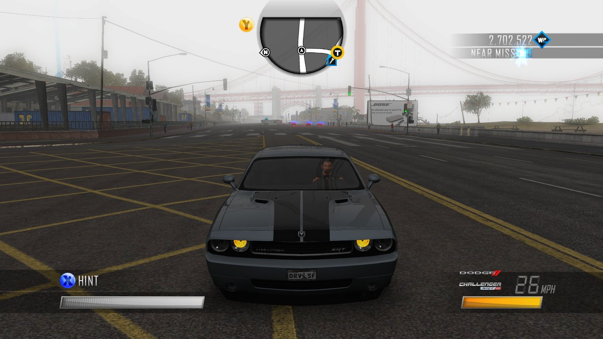
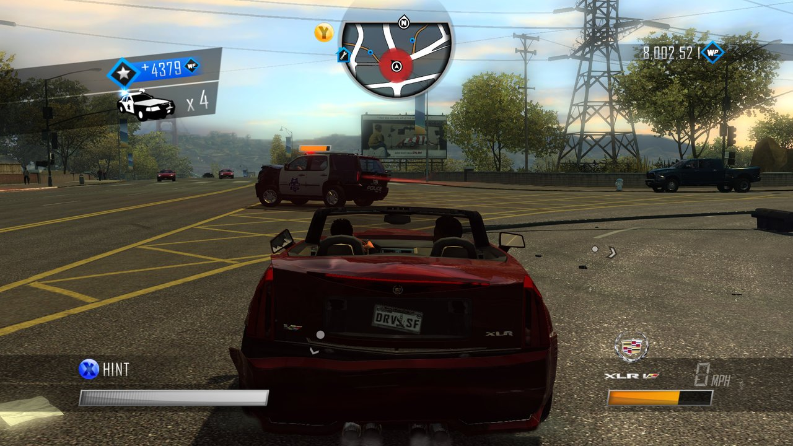
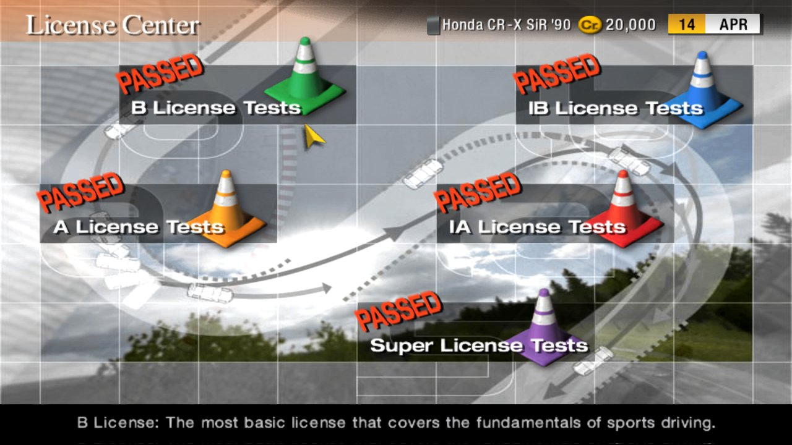

# Driver: San Francisco — Offline Mod v7.14

مود قائمة محلية للعب دون اتصال، من تطوير **Hossam Majrashi**.
[GitHub](https://github.com/Hossam-Majrashi)

**هذا المشروع يوزع المود، وليس اللعبة.** يلزم امتلاك نسخة مثبتة أصلية. لا تتضمن
حزمة النشر `Driver.exe` أو أرشيفات اللعبة أو أصواتها أو صورها أو ملفات الحفظ.
لا يقدم المود تجاوزًا للتفعيل أو متطلبات امتلاك اللعبة.

## لقطات من اللعبة / Gameplay Screenshots

<p align="center">
  
  
</p>
<p align="center">
  
</p>

## المزايا والنطاق

- قائمة عربية افتراضيًا مع اختيار الإنجليزية، وتكبير الواجهة.
- سرعات مستهدفة 100 / 200 / 300 / 400 / 500 MPH، بتعديل تدريجي لمحرك وقير
  مركبة اللاعب؛ ليست فرضًا مباشرًا للسرعة. الوصول للهدف والتحكم غير مضمونين
  لكل سيارة، خصوصًا 400 و500.
- إصلاح المركبة وحماية المحرك والهيكل، وخيارات RAM والنيترو والمال وWP
  وألوان المركبة الأصلية المدعومة.
- خيارات المرور والشرطة ومنع ركاب سيارة اللاعب وإشارات الانعطاف، ضمن نطاق
  التجول دون اتصال. منع الركاب يبدأ مفعّلًا؛ معظم تعديلات اللعب الأخرى تبدأ OFF.
- تجميد مؤقتات مهمات مدعومة وتغيير الإضاءة/السماء الأصلية. دعم Paranoia /
  TheSneakout محدود بمؤقتاتها ومؤشر الشك الموثقين؛ ليس دعمًا لكل عداد أو مهمة.
- أدوات **منفصلة** لفلترة الأصول المرئية والصوتية في نسخة محلية مُحضّرة.
  ليست أزرارًا في DLL، ولا تُفعّل تلقائيًا عند تنزيل المستودع.

لا تُساوي الاختبارات الآلية اختبار لعب شاملًا. تظل بعض الميزات تجريبية،
وتوجد حالات الدعم والتحقق المفصلة في [`release.json`](release.json).
إيقاف خيارات القائمة أو تحميل `--vanilla` لا يسترجع تعديلات أصول اللعبة على القرص.

## النسخة المدعومة

**Driver: San Francisco 1.04.1114، Windows x86، وضع Offline.**

SHA-256 لملف اللعبة المطلوب:

```text
c79987b0548f7130337c3f295c8fe269e120ceddad55c1159e6f5cbc6aa26616
```

البناء الحالي: [`build/dinput8.dll`](build/dinput8.dll).
بصمته: [`build/SHA256SUMS`](build/SHA256SUMS) و[`release.json`](release.json).

ضع مجلد المستودع باسم `mod` بجوار نسخة لعبتك:

```text
Driver San Francisco/
├── Driver.exe           # لعبتك الخاصة، غير موزعة هنا
└── mod/
    ├── build/dinput8.dll
    ├── src/
    ├── launch.sh
    └── ...
```

**احفظ وأغلق اللعبة قبل تثبيت DLL أو تحديثه أو تعديل الأصول.** لا تستبدل DLL
تابعًا لمود آخر ولا تتجاوز رفض بصمة غير معروفة. افتح القائمة بمفتاح **F1**.

## التشغيل

### Linux

المتطلبات: Bash وPython 3 وUMU وProton Experimental مثبت من Steam، وWine prefix
موجود مسبقًا تعمل فيه اللعبة. لا ينشئ المشغّل prefix جديدًا ولا يختار GE تلقائيًا.

من مجلد اللعبة:

```bash
./mod/launch.sh --check
./mod/launch.sh
```

لتحديد المسارات بدل الاكتشاف التلقائي:

```bash
DSF_WINEPREFIX="/path/to/existing-prefix" \
DSF_PROTONPATH="/path/to/Proton - Experimental" \
DSF_UMU="/path/to/umu-run" \
./mod/launch.sh
```

- الافتراضي للـprefix: `~/Games/driver-san-francisco`.
- التشغيل دون DLL المود: `./mod/launch.sh --vanilla`؛ لا يعكس تعديل الأصول.
- النسخ الاحتياطي التلقائي **متوقف افتراضيًا**. لتفعيله صراحةً للحفظ وتحديث DLL:
  `DSF_BACKUPS=1 ./mod/launch.sh`. عند تعطيله لا ينشئ المشغّل نسخًا احتياطية.
- طلب توافق PS4 المحدد `054c:05c4` عبر SDL/XInput يمكن إلغاؤه بـ
  `DSF_DS4_XINPUT=0 ./mod/launch.sh`. لا يُعد اكتشاف اليد إثباتًا لاستجابتها داخل اللعبة.

### Windows

ضع المجلد `mod` بجوار `Driver.exe`، وأغلق اللعبة، ثم شغّل `mod\launch.cmd`.
يتحقق PowerShell من النسخة والتعارضات. نسخ الحفظ اختياري فقط عند ضبط
متغير البيئة `DSF_BACKUPS=1`؛ الافتراضي لا ينشئ نسخًا احتياطية.
لا يحتاج البناء الجاهز إلى Proton أو Python لتشغيل DLL على Windows.
لا تعطل حماية النظام العامة إذا رفضت تشغيل السكربت؛ تحقق من المصدر والبصمة.

### macOS

`launch.command` غلاف **تجريبي** لـWine/CrossOver، وليس بناء macOS أصليًا.
يلزم Python 3 وbottle/prefix موجود تعمل به اللعبة ويدعم Windows x86:

```bash
cd mod
CX_BOTTLE="DriverSF" ./launch.command
# أو:
DSF_WINE="/path/to/wine" WINEPREFIX="/path/to/existing-prefix" ./launch.command
```

لم يُعتمد هذا المسار باختبار لعب شامل، خصوصًا مع اختلاف المعمارية ودعم 32 بت.

## الفلاتر المحلية الاختيارية

### فلتر الأصول المرئية

المصدر والاختبارات وقوائم الاختيار في [`asset_filter/`](asset_filter/README_AR.md).
يشمل استبدال صور مختارة وإخفاء هندسة مختارة وملحقًا لفيديوهات مقدمات المهمات؛
ليس استبدالًا عامًا لكل الشخصيات ولا حذفًا لمنطقها. البدائل تستخرج محليًا من اللعبة.

### فلتر الصوت — السياسة الثانية

المصدر في [`audio_filter/`](audio_filter/README_AR.md). يحدد الموسيقى بمراجع
البنوك وMusicTrack، ويحدد الحوارات النسائية بوسوم المتحدث الأخيرة. لا يكتم
مؤثرات التصادم والتنقل في الواجهة أو التسجيلات غير المحسومة تلقائيًا.
سياسة الفيديو الحالية تزيل صوت المسارات المختلطة كاملًا، بما فيه أصوات أخرى.

**تنبيه لمن ينزّل من GitHub:** الفلتران مصدر وأدوات محلية، وليسا حزمة تفعيل
مكتملة من clone نظيف. إعداداتهما المحضّرة ونسخهما الاحتياطية تتبع تثبيتًا بعينه،
ولا تُنشر. فلتر الصور يحتاج جرد DSF_Assets خاصًا، والصوت يحتاج جرد DSF_Audio
وأصوله المستخرجة. أدوات الاستخراج الكاملة ليست ضمن هذا المستودع. لا تستخدم خطة
جهاز آخر ولا تعتبر تطابق Driver.exe وحده إثباتًا لتطابق كل الأرشيفات.
أدوات إدارة الفلاتر الحالية تعتمد على Linux و`fcntl` و`/proc`؛ تعليمات تشغيل DLL
على Windows/macOS لا تعني دعم هذه الأدوات عليهما.

لنسخة **محلية مُحضّرة مسبقًا فقط**، ومن مجلد اللعبة:

```bash
python3 mod/audio_filter/manage.py verify
python3 mod/audio_filter/manage.py restore   # استرجاع صوت ما قبل التعديل
python3 mod/audio_filter/manage.py apply     # إعادة السياسة الحالية المُحضّرة
```

استرجع فلتر الصوت قبل تغيير فلتر الصور/الفيديو السابق الذي بُني الصوت على حالته.
إذا حذفت نسخ الاسترجاع وخططها، لن تستطيع هذه الأدوات إعادة الأصول السابقة؛
ستحتاج مصدرًا أصليًا آخر أو تحقق ملفات اللعبة. لا ترفع تلك الأصول أصلًا.

## البناء والاختبار

يلزم Zig وأداة Lua 5.1 للبناء. التبعيات المطلوبة من ImGui وMinHook والخط مرفقة
بتراخيصها. توليد العربية مجددًا يحتاج GNU FriBidi؛ الرؤوس المولدة الحالية محفوظة.

من مجلد `mod`:

```bash
./build.sh
python3 -m unittest discover -s tools -p 'test_*.py' -v
python3 audio_filter/test_manage.py
python3 asset_filter/test_manage.py
python3 asset_filter/test_video_filter.py
```

اختبارات C++ تحتاج g++ بدعم 32 بت وUBSan، واختبارات Lua تحتاج Lua 5.1.
اختبارات هندسة الصور تحتاج numpy. تعتمد اختبارات أخرى على التبعيات المتاحة وقد
تُتخطى عند غيابها. الاختبارات تستعمل محاكاة وملفات مؤقتة ولا تثبت سلوك اللعب كله.
لا تُوزع نماذج سكربتات خاصة مستخرجة من اللعبة؛ بعض الاختبارات الاختيارية تقرأ
نسخة يملكها المطور إذا عُيّن `DSF_GAME_EXE` صراحة.

## النشر على GitHub

**لا تضغط مجلد التطوير المحلي كله أو ترفعه بالسحب والإفلات.** قد يتضمن
نسخًا احتياطية وأرشيفات مُحضّرة لازمة للاسترجاع. `.gitignore` لا يفلتر ZIP يدويًا
ولا يمحو ملفات سبق تتبعها أو تاريخ Git.

أنشئ نسخة النشر بقائمة سماح من مجلد `mod`:

```bash
python3 tools/export_github.py --output /path/to/new-release/mod --zip
python3 tools/export_github.py --check /path/to/new-release/mod
```

ترفض الأداة استبدال مجلد موجود أو تضمين الروابط الرمزية والملفات الخاصة، وتتحقق
من بصمة DLL والتراخيص. تشمل الكود والبناء الحالي والتبعيات والإعداد المثال فقط؛
لا تشمل اللعبة أو الصوت/الصور المستخرجة أو الحفظ أو خطط الجهاز وسجلاته.
راجع [`PUBLISHING_AR.md`](PUBLISHING_AR.md) قبل الرفع.

## التراخيص

احتفظ بـ[`THIRD_PARTY_NOTICES.md`](THIRD_PARTY_NOTICES.md) وتراخيص ImGui وMinHook
وDejaVu مع المصدر والبناء. **لم يُختَر ترخيص مستقل لكود المود المؤلف**؛ إتاحة
المصدر على GitHub وحدها لا تجعله مفتوح المصدر بترخيص محدد، ولا تمنح حقوق أصول اللعبة.

---

## English summary

An offline **Windows x86** mod menu for Driver: San Francisco 1.04.1114. Requires a
legitimately owned installation; no game executable, assets, audio, saves or ownership
bypass is distributed. Install this repository as `mod` beside your `Driver.exe`.
Close the game before installation/updates. Use `launch.sh` on Linux with existing
UMU/Proton Experimental/prefix, `launch.cmd` on Windows, or the experimental
Wine/CrossOver `launch.command` wrapper on macOS. Press **F1** for the menu.

Speed targets and mission/world controls are experimental and not verified for every
vehicle or mission. `--vanilla` bypasses the DLL, not persistent game-asset edits.
Visual/audio filter tools require private installation-specific extraction inventories;
their generated inputs, backups and prepared assets are **not** public release files.
A complete fresh-clone filter bootstrap has not been packaged.

Build with `./build.sh` (Zig and Lua 5.1); run the commands above for host/mock tests.
Export using `python3 tools/export_github.py --output /new/path/mod --zip`, rather than
zipping your development directory. Keep third-party license notices. No independent
license has been selected for the authored mod code; see `THIRD_PARTY_NOTICES.md`.
